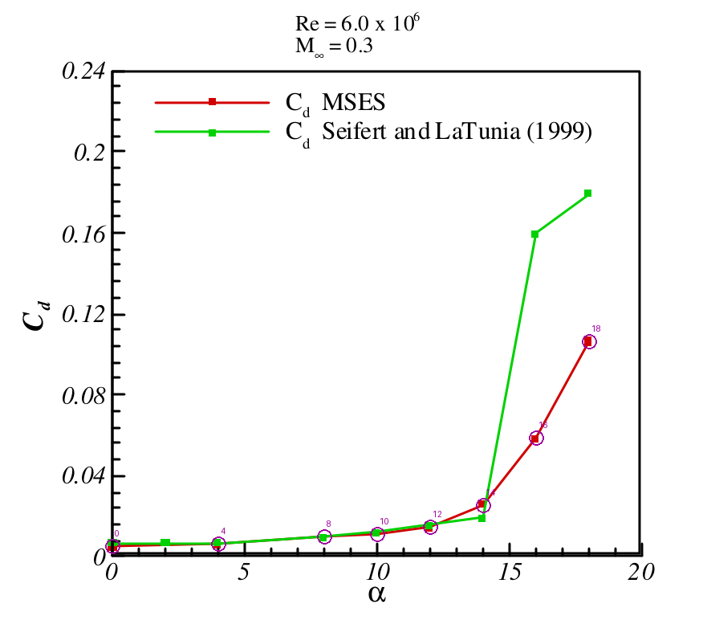

# Drag model and benchmarks

The viscous solver predicts two-dimensional **profile drag** from wake momentum
loss. Transition, boundary-layer growth and modeled separation affect that loss.
It is not a skin-friction-only calculation. Finite-wing induced drag and shock
drag are outside this implementation.

## What the output means

`polar.csv:CD` is the sum of the individual Squire–Young wake drag estimates,
using the common reference chord. Wakes are coupled to the potential flow but
remain separate and do not merge. Each extends approximately one reference
chord beyond the aftmost trailing edge under the default settings.

`metadata.json` also records `element_forces.<element>.CD_wake` and
`CD_friction`. **Do not add friction to CD_wake**: CD_wake already estimates
total profile drag. Subtracting friction gives a model pressure-drag remainder,
not an independent validation of pressure drag. The wake and surface CSVs allow
inspection of momentum thickness, displacement thickness, transition and Cf.

Detailed cove recirculation, merging wakes and massive separated flow remain
unresolved. Agreement in CL alone cannot establish CD accuracy. The benchmark
addition leaves the solver equations and closure parameters unchanged.

## Existing multi-element experimental comparison

NLR7301, nominal 2.6% gap, Re=2.51 million, Mach=0.185, assumed Ncrit=9:

| Incidence | Experimental CD | MultiFoil CD | Error, drag counts | Relative error |
|---:|---:|---:|---:|---:|
| 5.9908° | 0.022967 | 0.023220 | +2.53 | +1.10% |
| 13.0971° | 0.044592 | 0.067405 | +228.13 | +51.16% |

One drag count is 0.0001 CD. These are the two exact digitized drag incidences;
the lift observations use slightly different angles. Provenance and geometry
qualifications are in [README.md](README.md). See the archived
[force errors](results/nlr7301/force_errors.csv) for unrounded values.

The high-incidence discrepancy is substantial. These comparisons do not isolate
whether its main cause is geometry/transition mismatch, discretization, or the
flow and wake approximations. A matched multi-element MSES drag dataset is still
needed: the ICAS2006 NLR lift figure used in [MSES.md](MSES.md) supplies no CD.

The follow-on [optimization pilot](OPTIMIZATION_PILOT.md) adds the official MIT
MSES example's printed CD = 0.02264 at 6 degrees as qualified context in the
three-way plot. Its exact input geometry remains unconfirmed, so it is not a
new scored benchmark. The pilot also solves the nominal baseline at the same
CL = 2.484 and checks panel and wake sensitivity; see its report for both
fixed-incidence and fixed-lift differences. The earlier benchmark scores below
are unchanged.

## Added published MSES drag comparison

`naca0012_mses_drag` uses the red MSES CD(alpha) curve in Figure3, PDF/printed
page5, of Lima e Silva et al., *Numerical Study of Two-Dimensional High-Lift
Configurations Using the MSES Code*, COBEM2005.
[Primary paper](https://abcm.org.br/anais/cobem/2005/PDF/COBEM2005-0277.pdf).

The published case is NACA0012 at Re=6 million and Mach=0.3. We solve its eight
plotted incidences: 0, 4, 8, 10, 12, 14, 16 and 18 degrees. MultiFoil uses
260 panels, standard finite-TE coordinates and assumed Ncrit=9. The publication
does not establish the exact transition settings, geometry file, mesh or
executable version. MSES was not run here. This is a qualified single-element
code-to-code comparison, not a multi-element drag validation.

From the extracted project directory:

```bash
python validate.py --case naca0012_mses_drag --out mses_drag_benchmark
python validate.py --case naca0012_mses_drag --compare-only --out validation/results
python validation/extract_mses_drag_reference.py
# Optional verification against your downloaded original PDF; needs PyMuPDF:
python validation/extract_mses_drag_reference.py --pdf /path/to/COBEM2005-0277.pdf
```

Omit `--case` in the comparison command to regenerate the full aggregate report.
The default extraction check needs only the archived vector coordinates. The
optional PDF check verifies its SHA-256 and extracts the same red line segments.

## Extraction precision

The eight reference values come from the vertices of the published red line,
at the visible MSES markers. No extra incidence samples are interpolated.
PDF coordinates use points measured from the page's upper left. Calibration:
x=210/375 maps to alpha=0/20 degrees; y=260/109.25 maps to CD=0/0.24.

The graph is coarse even though its paths are stored as vectors. A vertical
allowance of 0.75 PDF point corresponds to about **0.0012 CD, or 12 drag counts**;
the incidence allowance is 0.10 degree. These are graphical reading allowances,
not MSES uncertainty bounds. Six decimal places in the CSV support deterministic
extraction and must not be interpreted as six-digit accuracy. Error intervals
use the vertical allowance only; horizontal incidence uncertainty is documented
separately and is not propagated into CD error bars.



Source: Lima e Silva et al., COBEM2005 Figure3, copyright2005ABCM. Magenta circles
and incidence labels identify the selected points. Green experimental values
shown in the source crop are not scored. The crop, original PDF hash, archived
paths and calibration are under `data/naca0012_mses_drag/` and `sources.json`.
Those experimental values are now extracted separately for the visual overlay
in [THREE_WAY.md](THREE_WAY.md); the existing benchmark scores remain unchanged.


## Executed drag results

All **8/8** requested points converged. The solver also flags local supersonic
flow at **12, 14, 16 and 18 degrees**; those values remain visible as stress
comparisons. This potential-flow compressibility correction does not resolve
shocks. A small residual does not establish model validity at these conditions.

| Incidence | Published MSES CD (graphical) | MultiFoil CD | Error, drag counts | Local supersonic flag |
|---:|---:|---:|---:|---|
| 0° | 0.004776 | 0.005169 | +3.93 | No |
| 4° | 0.005970 | 0.006133 | +1.63 | No |
| 8° | 0.009552 | 0.008524 | -10.28 | No |
| 10° | 0.010746 | 0.010875 | +1.29 | No |
| 12° | 0.014328 | 0.013998 | -3.30 | Yes |
| 14° | 0.025075 | 0.019450 | -56.25 | Yes |
| 16° | 0.058507 | 0.034685 | -238.22 | Yes |
| 18° | 0.106269 | 0.086637 | -196.32 | Yes |

The four points from 0 through 10 degrees have CD RMSE **0.000560 (5.60 drag
counts)**; all lie inside the ±12-count graphical allowance. This is a coarse
agreement check and cannot demonstrate accuracy to 5.6 counts. The model falls
below the reference drag rise at 14–18 degrees. The maximum difference is
**−0.023822 (−238.22 counts)** at 16 degrees. Across all eight points, RMSE is
0.011101 (111.01 counts), combining the ordinary and flagged stress comparisons.
These differences have not been corrected by fitting.


Complete results, reference intervals and model-validity flags are in
`results/naca0012_mses_drag/`. The aggregate report now gives drag errors in
counts for every case containing CD. The two new integrity checks cover a
CD-only reference with no inferred CL/stall observation and exact reproduction
of the archived drag samples; all **10 comparison tests pass**.

## What remains to establish drag accuracy

A stronger multi-element check needs MSES CD values paired with the actual
geometry, chord convention, incidence or target CL, Re, Mach, Ncrit/trips and
convergence status. A CD(CL) polar must be compared at the same CL; it cannot be
silently treated as CD(alpha). Matching conditions and mesh/wake-length
sensitivity should precede any conclusion that the remaining error is solely
due to a closure. No new mesh or wake-length sensitivity run was performed for
this addition. Wake confluence and separated cove physics remain development
work, not capabilities established by the NACA0012 comparison.
