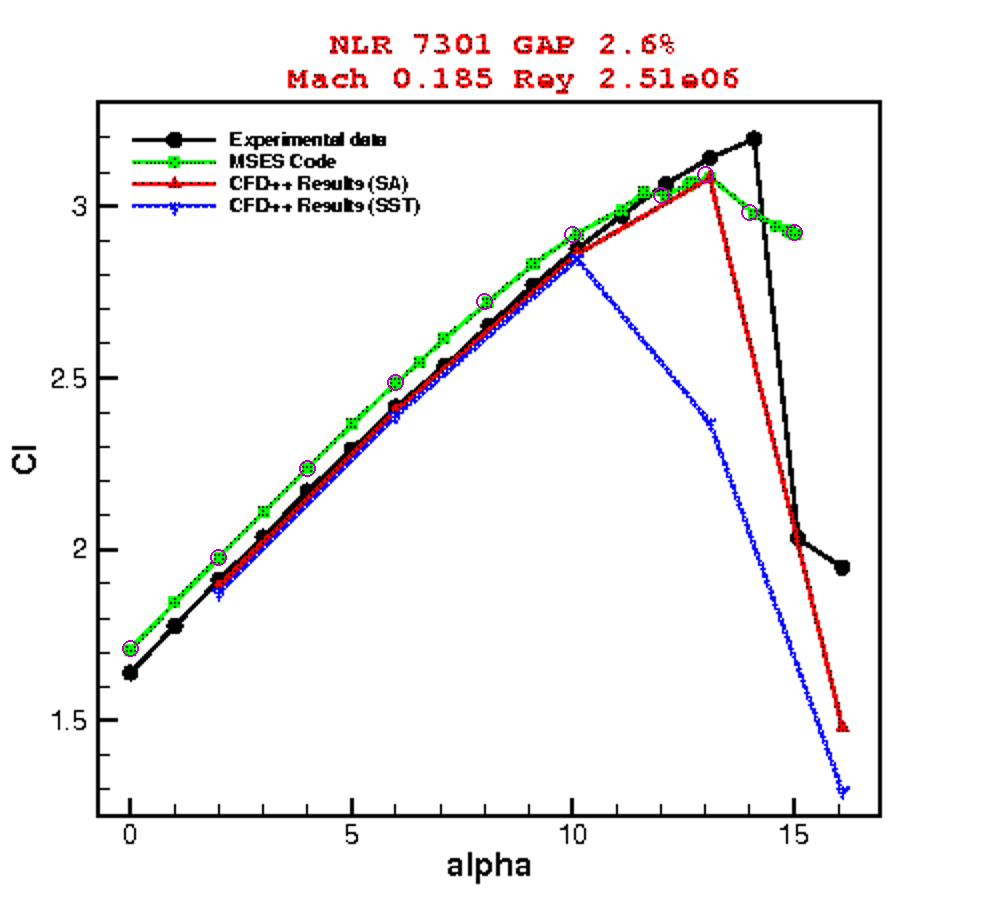

# Benchmarks against published MSES results

The suite contains the NLR7301 lift comparison documented below and a separate
NACA0012 drag comparison documented in [DRAG.md](DRAG.md). Both are included
in the default run. Their source conditions and observables are kept separate.

The `nlr7301_mses` case compares this solver with the **MSES CL curve** in
Figure 6, page 6, of Neto et al., *Aerodynamic Study of High-Lift Device
Configurations for Take-off and Landing Conditions*, ICAS 2006.
[Primary paper](https://www.icas.org/icas_archive/ICAS2006/PAPERS/512.PDF).

This is a code-to-code comparison to published results. MSES was not executed
here, and agreement with its curve is not independent experimental validation.
The aerodynamic solver was not modified or fitted for this addition.

## Execute or inspect

From the extracted `multifoil` directory:

```bash
python validate.py --case nlr7301_mses --out mses_benchmark
python validate.py --case nlr7301_mses --compare-only --out validation/results
python validation/extract_mses_reference.py
```

The first command runs MultiFoil and compares against bundled MSES references;
no MSES installation or license is required. The second uses archived MultiFoil
outputs and writes a report for the selected case. To restore the aggregate
report for all five default cases, omit `--case`. The third checks that the
reference CSV is exactly reproduced from the source figure and calibration.

## Conditions and scope

| Item | Published reference / configured comparison |
|---|---|
| Geometry | NLR7301 main element with nominal 32% flap, 20° deflection |
| Gap / overlap | Nominal 2.6% gap and 5.3% overlap, based on cruise reference chord |
| Reynolds number | 2.51 million, based on the common reference chord |
| Mach number | 0.185 |
| Angles sampled | 0, 2, 4, 6, 8, 10, 12, 13, 14, 15° |
| Reference observable | Total CL from the green MSES curve in Figure 6 |
| MultiFoil mesh | 260 main / 180 flap panels |
| MultiFoil transition | Natural transition, Ncrit=9 assumption |

The original MSES input files, exact coordinate file, grid, Ncrit, forced trips,
convergence threshold and executable version are not given. The paper cites an
MSES 2.92 manual; this does not establish the binary version used. The original
[Lima e Silva et al. MSES study, COBEM 2005](https://abcm.org.br/anais/cobem/2005/PDF/COBEM2005-0277.pdf)
was also checked and does not close those gaps. Its ambiguous Figure 10 caption
is not used as a numeric source.

MultiFoil uses the existing, nominal ECARP assembled coordinates. Its base mesh
gives a closest main-TE/flap distance of approximately 0.02652 reference chords.
The reported nominal configuration is matched; exact geometry and input-deck
identity are unverified. Ncrit=9 is an explicit assumption, not a claimed MSES
setting. No flap-deformation or angle correction was fitted.

For this NLR case, only CL and a **sampled lift peak** are compared with MSES. Computed CD, CM, Cp,
transition and separation remain in the raw outputs, but no MSES accuracy metric
is assigned to them. The pressure plots elsewhere in the paper concern a 1.3%
gap and must not be silently substituted for this 2.6% case.

## Extraction audit

`data/nlr7301_mses/source_figure6.png` is the unchanged 494×456 embedded figure
from the primary PDF (page 6, image xref 46). Source PDF and figure hashes,
axis calibration, color selection and graphical reading allowances are recorded
in `sources.json` and `data/nlr7301_mses/digitization.json`.

The extractor samples the green curve at the prescribed angles using the median
green pixel height within 1.5 pixels of each target column. It rejects ambiguous
or missing samples. Calibration uses the labeled alpha=0/15° and CL=1.5/3.0
ticks. Samples can lie between the original MSES markers: they are **graphical
curve samples, not recovered native solver records**. MultiFoil is solved at
each prescribed angle; its solution values are never interpolated for scoring.

CL is rounded to 0.001 with a ±0.015 reading allowance, and the incidence
reading allowance is ±0.10°. These describe graphical reading precision, not
MSES numerical uncertainty or experimental error. Green/red overlap near the
peak is a reason to retain the allowance. The plotted series and sample overlay
were visually checked.



Figure source: Neto et al., ICAS 2006, Figure 6; magenta circles mark extraction
locations added for this benchmark. Copyright in the original figure remains
with its owner. No proprietary MSES software or input deck is redistributed.

## Executed results

All **10/10** requested states converged. Errors below are MultiFoil minus the
digitized published MSES reference, in absolute CL units.

| Measure | Result |
|---|---:|
| CL bias | +0.01835 |
| CL MAE | 0.06629 |
| CL RMSE | 0.07283 |
| Maximum absolute CL difference | 0.12137 |
| MultiFoil sampled maximum | CL=3.0374 at 12° |
| MSES graphical sampled maximum | CL≈3.093 at 13° |

MultiFoil runs approximately 0.04–0.09 CL above MSES from 0° through 10°, then
falls below it after 12°. The one-degree difference between sampled peaks is
not a resolved stall-angle error: both graphical reading and the coarse angle
grid limit that interpretation. The omitted MSES settings and unresolved grid
error prevent attributing the differences solely to aerodynamic closures.


The gray experimental points are the separately documented NLR dataset and
provide context only. They do not enter the MSES error statistics. This prevents
agreement with a numerical reference from being mislabeled as agreement with
measurements.

Complete coefficients, errors, residuals and actual geometry are in
`results/nlr7301_mses/`. `comparison.json`, `force_errors.csv` and the aggregate
report explicitly label this reference as `published_solver` / `Published MSES`.

Refinement and transition sensitivity can be run with `--panel-scale 1.5` and
`--ncrit 11` in separate output directories. These studies have not been executed
for this benchmark. They can assess MultiFoil sensitivity but cannot recover the
unreported MSES settings.
